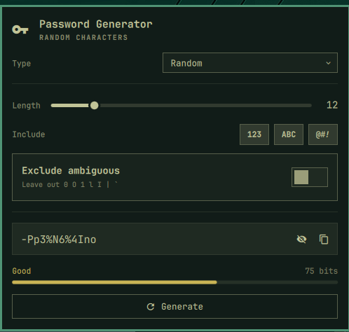

# Password Generator for Omarchy

A password generator that lives in the Omarchy bar. Click the key icon, get a
password, copy it, and let it wipe itself from the clipboard.



This is an Omarchy port of [menubarpassgen](https://github.com/adamjohnlea/menubarpassgen),
a macOS menu bar app. Same generation algorithms, same word list, same strength
scoring — rebuilt as a shell plugin instead of a Swift app.

## What it does

Five password types:

| Type | Example | Options |
|---|---|---|
| **Random** | `rW-2m+ReXW3Q` | length 8–32, digits / uppercase / symbols, exclude ambiguous characters |
| **Pronounceable** | `Thiboublierous22` | length 6–32, capitalize, append digits |
| **Passphrase** | `Stoic-Dusk-Hunter-Gust-Seismic-Falcon-742` | 3–8 words, separator, capitalize, append a number |
| **PIN** | `12404023` | 4–12 digits, avoid consecutive repeats |
| **Hex** | `2251D364788E389677DB92412150ED45` | length 8–64, upper or lower case |

Every enabled character set in a Random password is guaranteed to appear at
least once, so the result satisfies sites that demand a mix. The chips are the
only control — there are no separate minimum-count dials.

The strength bar shows both a rating and the entropy the current settings
actually buy you. Passphrase entropy is computed from the real word list size
(log₂ 521 ≈ 9.02 bits per word), so it is honest rather than flattering. PINs
are capped at "Weak" no matter their length, because they are.

## Security

- **Generated with a CSPRNG.** Every choice goes through Python's `secrets`.
  Nothing uses `random`, and nothing uses QML's `Math.random`.
- **Never written to disk.** Only your settings are persisted. The password
  itself is dropped when the panel closes.
- **Never passed as a command-line argument.** `argv` is world-readable through
  `/proc`, and `wl-copy` stays resident to serve the clipboard, so the password
  is piped over stdin instead.
- **Hidden from clipboard history.** Copies go out with `wl-copy --sensitive`,
  which offers the `x-kde-passwordManagerHint` MIME type. Omarchy's own
  clipboard manager greps for exactly that and skips the entry.
- **Clears itself.** After a delay the clipboard is wiped — but only if it still
  holds the password that was copied, so it never clobbers something you copied
  afterwards. The pending clear survives closing the panel, which is the normal
  way to use it.
- **Offline.** No network access, no telemetry.

## Install

```bash
omarchy plugin add https://github.com/adamjohnlea/omarchy-passgen.git
omarchy plugin enable adamjohnlea.passgen --section right
```

Or by hand: clone into `~/.config/omarchy/plugins/adamjohnlea.passgen/`, then
`omarchy-shell shell rescanPlugins` and enable it.

Move it around the bar with `omarchy bar move adamjohnlea.passgen --section left`.

## Use

Click the key icon. A password is generated the moment the panel opens, so
usually you can just copy and go.

| Key | Action |
|---|---|
| `Return` | Generate a new password |
| `c` | Copy to clipboard |
| `h` | Hide / show the password |
| `Esc` | Close |

## Settings

Two settings live on the bar entry, editable in Omarchy's plugin settings or
directly in `~/.config/omarchy/shell.json`:

```json
{ "id": "adamjohnlea.passgen", "autoClearClipboard": true, "clipboardClearSeconds": 30 }
```

Set `autoClearClipboard` to `false` to keep copied passwords indefinitely.

Everything else — the type, lengths, and toggles — is remembered as you change
it, in `~/.local/state/omarchy-passgen/settings.json`.

## The CLI

The generation engine is a standalone script with no dependency on the shell:

```bash
~/.config/omarchy/plugins/adamjohnlea.passgen/passgen random --length 20 --no-symbols
~/.config/omarchy/plugins/adamjohnlea.passgen/passgen passphrase --words 5 --separator .
~/.config/omarchy/plugins/adamjohnlea.passgen/passgen hex --length 64 -n 5
```

`passgen --help` lists every type and flag.

## Development

```
manifest.json      plugin metadata, bar widget declaration, settings schema
Panel.qml          the bar icon and the popup panel
Model.js           strength scoring and the engine's argument list
passgen            the generation engine (Python 3, stdlib only)
wordlist.txt       521 words; the single source of truth for passphrase entropy
clipboard-clear    clears the clipboard only if it still holds the password
tests/             unit tests for the engine
```

Run the tests:

```bash
python3 tests/test_passgen.py
```

**Note:** saving a file under `~/.config/omarchy/plugins/` hot-reloads plugin
code, but IPC handler registration does not refresh. Run `omarchy restart shell`
when testing, or you will be debugging stale QML.

## Differences from the macOS app

- No in-app purchase, no Pro tier — all five types are just there.
- No batch generation.
- The macOS Settings window becomes two entries in Omarchy's plugin settings.
- "Launch at login" is meaningless here: the widget is part of the bar.
- The clipboard concealment marker is the Wayland/KDE `x-kde-passwordManagerHint`
  rather than macOS's `org.nspasteboard.ConcealedType`.

## License

MIT
